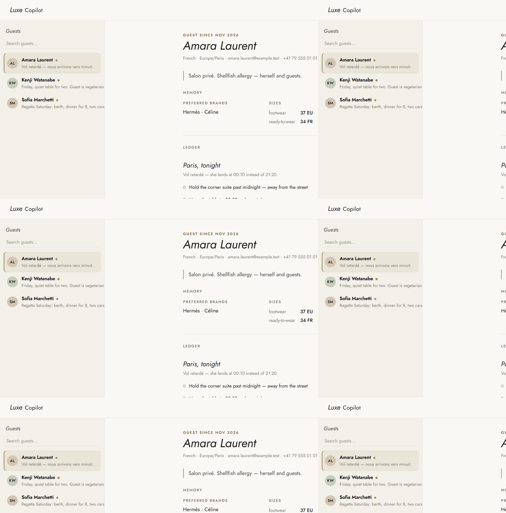
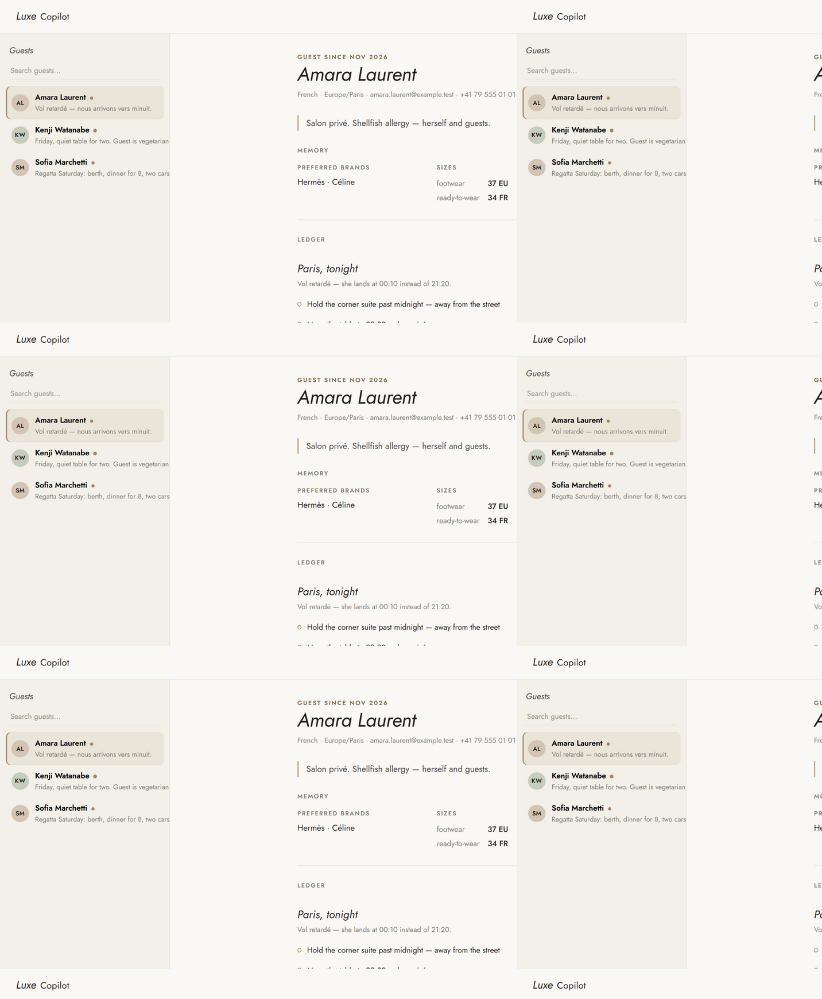
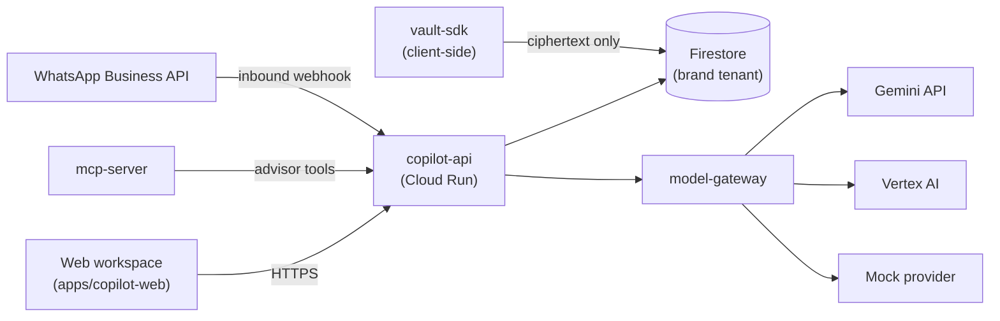

# Luxe

Open-source client intelligence and advisor enablement platform for the luxury industry.

[](https://github.com/fayaz316/Luxe-AI/actions/workflows/ci.yml)
[](#license)
[](#quickstart)

## Positioning

Luxe brings luxury houses what no legacy tool or generic AI platform offers: the advisor's desk with complete client memory, AI-drafted correspondence in the house's voice, and request coordination across the whole ecosystem — the hotel, the boutique, the gallery, the marina, the theatre — on one ledger, confirmed by a human hand. Every outbound message passes an explicit approval gate. Client memory belongs to the client; brand data belongs to the brand.

## What each audience gets

| Audience | Value |
| --- | --- |
| Advisors | Complete client memory per brand, drafted communications, approval control over every outbound message |
| Brands | Deployment in their own Google Cloud project, no data egress, choice of model provider |
| Clients | An encrypted profile they own, no ad targeting |

## The desk

Luxury advisors usually piece together guest preferences, scattered WhatsApp threads, and separate calls to the hotel, chauffeur, and theatre whenever a guest's plans change. Luxe brings the entire picture into one workspace (shown below with fictional Maison Verre data — see [docs/DEMO.md](docs/DEMO.md)):

- **Guest dossier & Request Ledger** — On the left, the guest roster; in the center, client memory (preferred brands, sizes, interests, allergies) paired with a live **Request Ledger** that turns a single flight delay (*"Vol retardé — she lands at 00:10 instead of 21:20"*) into coordinated, per-step confirmations across the house, transport, and theatre; on the right, the full correspondence timeline.



- **Mandatory human approval gate** — The model drafts replies in the house's voice using the guest's memory and recent context, but **nothing ever reaches a guest automatically**. Every reply pauses under *Awaiting your hand*, where the advisor can edit the copy, regenerate, reject, or explicitly approve & send.



## Architecture



Vault records are encrypted client-side by `vault-sdk`; stored systems hold ciphertext only. The model layer is provider-neutral (`Gemini`, `Vertex AI`, or a deterministic mock). Full detail: [docs/ARCHITECTURE.md](docs/ARCHITECTURE.md).

## Quickstart

Requires Node 20+ and pnpm 12+.

```bash
pnpm install
pnpm demo
```

- Web app: http://localhost:5173
- API: http://localhost:8080

The demo seeds a fictional hotel and dining client base, "Maison Verre". All demo data is fictional. Walkthrough: [docs/DEMO.md](docs/DEMO.md).

### Commands

| Command | Purpose |
| --- | --- |
| `pnpm install` | Install workspace dependencies |
| `pnpm typecheck` | Type-check all packages |
| `pnpm test` | Run all tests |
| `pnpm build` | Build all packages |
| `pnpm demo` | Run the seeded demo (API + web app) |

### Configuration

| Variable | Component | Purpose |
| --- | --- | --- |
| `PORT` | copilot-api | HTTP port (default 8080) |
| `COPILOT_API_KEY` | copilot-api | Optional shared secret; when set, all endpoints except health and the WhatsApp webhook require the `x-api-key` header |
| `GEMINI_API_KEY` | copilot-api | Selects the Gemini API-key provider |
| `GOOGLE_PROJECT` / `GOOGLE_APPLICATION_CREDENTIALS` | copilot-api | Selects the Vertex AI provider |
| `FIRESTORE_PROJECT` | copilot-api | Enables the Firestore store; default is in-memory |
| `WHATSAPP_VERIFY_TOKEN` | copilot-api | WhatsApp webhook verification token |
| `SEED_DEMO` | copilot-api | Seeds the fictional demo dataset (`1`) |
| `VITE_API_URL` | copilot-web | API base URL |
| `VITE_API_KEY` | copilot-web | Shared secret sent as `x-api-key`, when the API requires one |
| `COPILOT_API_URL` | mcp-server | copilot-api base URL |
| `COPILOT_API_KEY` | mcp-server | Shared secret forwarded as `x-api-key`, when the API requires one |

## Repository

| Path | Purpose |
| --- | --- |
| `apps/copilot-web` | Advisor web workspace |
| `packages/copilot-api` | Advisor API: client memory, drafting, request ledger, approval gate, WhatsApp webhook |
| `packages/model-gateway` | `ModelProvider` abstraction: Gemini API key, Vertex AI, deterministic mock |
| `packages/vault-sdk` | Client-held envelope encryption for vault records |
| `packages/mcp-server` | MCP server exposing advisor tools over the copilot API |
| `infra/terraform` | Per-brand Google Cloud deployment (Cloud Run, Firestore, Secret Manager, Artifact Registry, IAM) |
| `docs` | Architecture, threat model, deployment, demo, ADRs |

## Charter

The project is governed by five commitments — [CHARTER.md](CHARTER.md):

- No advertising.
- No plaintext access to client vault data.
- No waitlist or allocation manipulation.
- Human approval on all irreversible actions.
- Brand data stays in the brand's boundary.

## Deployment

Each brand deploys Luxe into its own Google Cloud project. Instructions: [docs/DEPLOYMENT.md](docs/DEPLOYMENT.md). In production, combine the optional API key (`COPILOT_API_KEY`) with Cloud Run invoker IAM; neither alone is sufficient defense.

## Roadmap

Milestones are version-ordered and carry no dates: [ROADMAP.md](ROADMAP.md).

## License

Apache-2.0. Copyright 2026 Luxe contributors.
