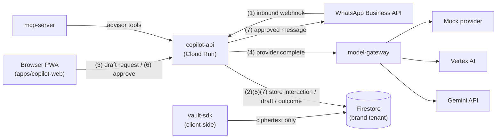

# Architecture

## System overview

Numbers correspond to the request lifecycle in the next section.

## Component responsibilities

| Component | Responsibility |
| --- | --- |
| `apps/copilot-web` | Advisor workspace: client memory, interaction timeline, draft composition, approval |
| `packages/copilot-api` | Advisor API: client records, drafting, the approval gate, WhatsApp webhook; owns the request lifecycle |
| `packages/model-gateway` | `ModelProvider` interface and implementations (Gemini API key, Vertex AI, deterministic mock); `resolveProvider()` selects by environment |
| `packages/vault-sdk` | Client-side envelope encryption of vault records; runs on the client device, emits ciphertext |
| `packages/mcp-server` | MCP server exposing advisor tools (client lookup, draft, approve/reject) over the copilot API |
| `infra/terraform` | Per-brand Google Cloud tenant: Cloud Run, Firestore, Firebase Hosting, Secret Manager, least-privilege IAM |

## Request lifecycle of a draft

1. **Inbound webhook.** A client message arrives from the WhatsApp Business API at `/webhook/whatsapp`. The API verifies the token and stores the interaction.
2. **Interaction stored.** The inbound message is recorded against the client timeline in the data store.
3. **Draft requested.** The advisor requests a draft from the workspace (or an MCP client invokes the draft tool). The API assembles the drafting context: profile memory, preferences, and recent interactions.
4. **Model call.** The API calls `provider.complete` through `model-gateway`; `resolveProvider()` has selected Gemini, Vertex AI, or the mock from the environment.
5. **Pending approval.** The draft is stored with status `pending_approval`. No outbound path can read it except approval.
6. **Advisor approves.** The advisor reviews, edits if needed, and explicitly approves (or rejects). Approval is per message; there is no bulk or implicit approval.
7. **Outbound interaction recorded.** The approved message is delivered and the outbound interaction is written to the client timeline.

## Data stores

- **In-memory (default).** Used when `FIRESTORE_PROJECT` is unset. Suits development and the demo; data is lost on restart.
- **Firestore (per tenant).** Enabled by `FIRESTORE_PROJECT`. Holds clients, interactions, and drafts for exactly one brand within that brand's Google Cloud project. Vault records arrive as ciphertext and are stored as ciphertext.

## Model layer

All model access goes through the `ModelProvider` interface in `packages/model-gateway`. Selection by environment: `GEMINI_API_KEY` selects the Gemini API-key provider; `GOOGLE_PROJECT` with `GOOGLE_APPLICATION_CREDENTIALS` selects Vertex AI; otherwise a deterministic mock serves tests and local development. Core paths depend on the interface only — see [adr/0003-model-provider-abstraction.md](adr/0003-model-provider-abstraction.md).

## Vault

The vault holds four record kinds: preferences, sizing, collection, and interaction history. `packages/vault-sdk` runs on the client device and applies AES-GCM envelope encryption:

- A per-record data encryption key (DEK) encrypts exactly one record.
- The record identifier and kind are bound as additional authenticated data (AAD), so ciphertext moved between records or tampered with fails authentication.
- The DEK is wrapped by the client's master key, which never leaves the client device.
- The store receives the ciphertext and the wrapped DEK — nothing decryptable by any server-side component.

See [adr/0002-client-vault-ciphertext-only.md](adr/0002-client-vault-ciphertext-only.md).

## Request ledger

A request (`ClientRequest`) decomposes one guest need into steps (`RequestStep`) across the house and its partners — boutique, gallery, marina, transport, theatre. Steps are inert until the advisor confirms them (`POST /requests/:id/steps/:stepId/approve`); a guest-facing step records its outbound communication at confirmation, under the same gate as drafted replies. See [adr/0005-request-ledger.md](adr/0005-request-ledger.md).

## MCP surface

`packages/mcp-server` exposes three advisor tools over the copilot API (`COPILOT_API_URL`): client lookup, draft, and approve/reject. MCP clients exercise the same API paths as the web workspace; the approval gate is enforced server-side and cannot be bypassed from the client side.

## Deployment topology

Each brand deploys into its own Google Cloud project via `infra/terraform`: Cloud Run runs the API, Firestore stores tenant data in the chosen region, Firebase Hosting serves the web app, Secret Manager holds credentials, and IAM is least-privilege. There is no shared tenancy and no central data plane. See [DEPLOYMENT.md](DEPLOYMENT.md) and [adr/0001-tenant-isolation-on-google-cloud.md](adr/0001-tenant-isolation-on-google-cloud.md).

## Design principles

- **Approval-first.** Irreversible actions require an explicit human approval, enforced at the API layer rather than in any single client.
- **Tenant isolation.** One cloud project per brand; no central estate, no cross-brand aggregation.
- **Provider abstraction.** Model access sits behind `ModelProvider`; providers are selected by configuration, never compiled into core paths.
- **Client-held keys.** Vault decryption is possible only on the client's device; every other system handles ciphertext.
